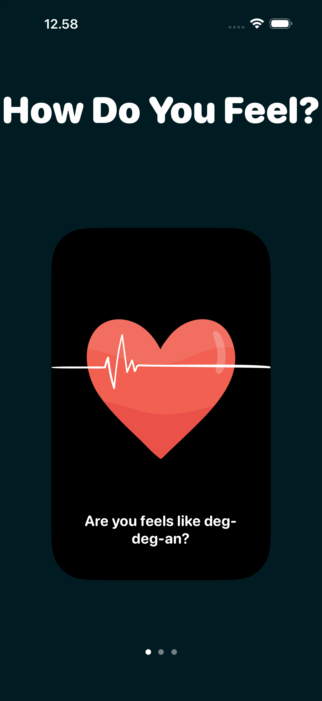

# BreathingApp

A mood-first iOS wellness app built for **Apple Developer Academy Challenge 1**. The home screen asks one question — *"How Do You Feel?"* — and routes you to the right feature based on your answer.

## What it does

| You feel… | The app takes you to… |
| --- | --- |
| Nervous, heart racing (*deg-deg-an*) | Guided breathing session with a visual companion |
| Restless, need calm | Soothing music |
| Stiff body (*kaku beut*) | Movement routine |

## Features

- **Home** — swipeable mood cards (*"How Do You Feel?"*) presented as sheets over a dark, rounded-card UI
- **Guided breathing** — step-by-step breathing flow (description → start point → guiding)
- **Soothing music** — dedicated screen for calming audio
- **Movement** — body movement feature
- Custom illustration assets and dark theme with rounded `ui-rounded` typography

## Tech

- Swift + SwiftUI
- No third-party dependencies
- MV-style feature folders (`App`, `Features`, `Components`, `UI`, `Assets`)

## Requirements

- Xcode 26+
- iOS 26.4+ (simulator or device)

## Run

1. Clone the repo
2. Open `C1 App.xcodeproj` in Xcode
3. Pick an iPhone simulator and press ⌘R

## Screenshots

| Home | Breathing | Music | Movement |
| --- | --- | --- | --- |
|  |  |  |  |

---

*Apple Developer Academy — Challenge 1 · [Noor Akhnafal Aban](https://github.com/akhnafal-aban)*